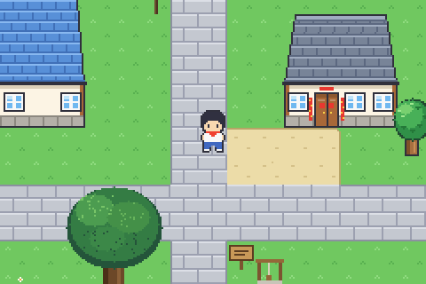
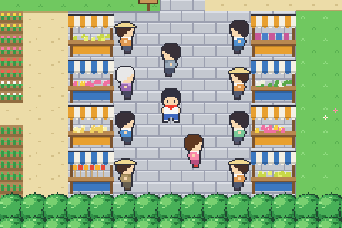
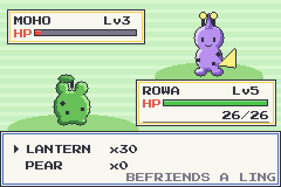
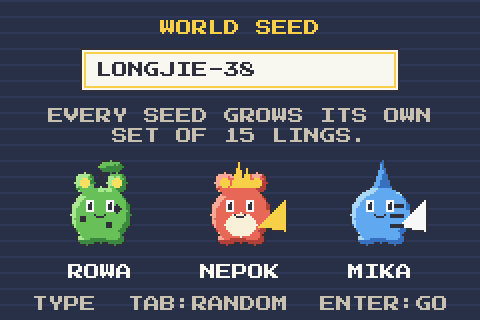
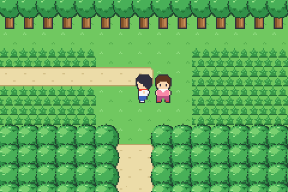
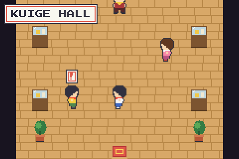
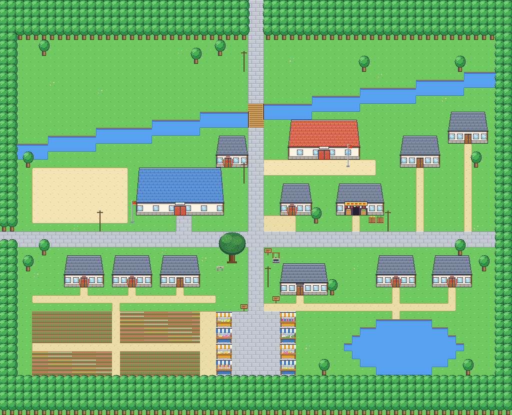

# Longjie

**I turned my hometown into a pixel-art monster-catching game.**

Longjie is the old market street in Chenggong, Kunming, where I grew up. Every place in this game is real: my home on the main street, Longjie Primary School just up the road, Chenggong No.1 Middle School, Jinlong Market, Zhang Tianxu's old home fifty metres from my door, Santai Hill to the north, Gucheng and Kuige Hall to the west. I laid them out the way I remember walking between them as a kid, with the distances shortened so the town fits in a game.

On every day of the month ending in 3 or 8, people from all over Chenggong came to our street for the market, and the whole place was packed. The game reads the real calendar, so the market shows up on those days there too.

It plays like the handheld monster-catching RPGs I loved as a child: leave home, choose a partner, walk into the tall grass, cross to the next town, challenge the hall. I made it so I could walk through my childhood again.

**[Play it in the browser](https://zhangnzhang.github.io/longjie/)** (needs a desktop keyboard)

 
 
 

## What is different about it

**The map is a real place.** The layout follows the real geography: Santai Hill to the north, the canal cutting through town, Longjie's main street running north to south, the primary school, Chenggong No.1 Middle School, Zhang Tianxu's old home, Gucheng and Kuige Hall to the west. Distances are compressed, directions are kept.



**The market follows the real calendar.** Longjie has always held its street market on days ending in 3 and 8. The game reads today's date: on the 3rd, 8th, 13th, 18th, 23rd and 28th the square fills with stalls and people. On other days the tables stand empty. Press `M` to preview a market day.

**Every creature is grown from a seed.** There are no hand-drawn monsters. A seed string deterministically generates all 15 creatures ("Lings"): names, types, stats, move lists, evolutions and the sprites themselves, front and back. Type a different seed on the new-game screen and the three partners redraw as you type. The same seed always gives the same world, so seeds can be shared.

**No asset files.** Tiles, buildings, characters, creatures, music and sound effects are all produced by code at load time; the 8x8 font is baked into the source as a bitmap. The whole game is one HTML file of about 75 KB.

## Controls

| Key | Action |
|---|---|
| Arrows / WASD | Move |
| Z / Space | Talk, read, confirm |
| X / Shift | Run, cancel |
| Enter | Party and bag (Z puts the selected Ling in the lead) |
| M | Preview market day |
| N | Sound on / off |

Progress saves automatically in the browser.

## How it works

| File | What it does |
|---|---|
| `src/maps.js` | World data and a tiny map-building DSL. Pure data, testable in Node. |
| `src/render.js` | All tile, building, prop and character art, drawn with code. |
| `src/gen.js` | The seed system: bestiary generation and the procedural creature sprites. |
| `src/battle.js` | Turn-based battles, written as a queue of small steps. |
| `src/audio.js` | Chiptune sequencer and sound effects on Web Audio. |
| `src/main.js` | Engine: movement, camera, y-sorted drawing, dialogue, story, saving. |
| `src/ui.js`, `src/gfx.js`, `src/state.js` | Text, input, drawing helpers, game state. |

A few details worth a look:

- **Creature sprites** are drawn as coloured shapes into a 56x56 index buffer (body, head, ears, tail, wings, type emblem, markings, face), then a second pass adds the outline and derives light and shadow from the silhouette. One function produces every creature and its back view.
- **Type chart**: six types (Leaf, Fire, Water, Earth, Wind, Spark). Leaf, Fire and Water form the classic triangle; Earth, Wind and Spark cut across it.
- **Battles** are a queue of messages, HP-bar tweens, waits and callbacks. Steps can enqueue more steps, so a move, a faint, experience, a level-up and an evolution chain naturally.
- **Drawing order**: the ground is painted once per map; trees, buildings, props and people are sorted by their base line every frame, so you can walk behind things.

## Build and test

```
npm install
npm run build      # bundles src/ into dist/index.html and docs/index.html
npm test           # reachability check of every map, plus scripted playthroughs in a headless browser
```

The tests walk the world graph to make sure every door, exit, sign and person can be reached, then play the opening, a capture, a party switch, a loss, the Kuige Hall challenge and a save/load round trip in a headless browser. They use Playwright; after `npm install`, run `npx playwright install chromium` once.

## Credits

Design and direction by Johnny. Code and pixel art written with Claude. The bitmap font is baked from Press Start 2P (SIL OFL 1.1, see `licenses/`). All creatures, characters, maps and music are original.

---

## 中文简介

我把老家做成了一个像素风的怪兽收集游戏。

龙街是昆明呈贡的一条老街，我在这里长大。游戏里的每个地方都是真的：正街上的我家，往上走的龙街小学，呈贡一中，金龙超市，离我家五十米的张天虚故居，北边的三台山，西边的古城和魁阁。它们的位置按我小时候走过的记忆来摆，只是把距离缩短了。

逢三逢八赶龙街，呈贡周边的人都会来，整条街都是人。游戏读取真实日期，到了这几天，街上的集市也会摆出来。

玩法是我小时候最喜欢的那种掌机怪兽收集游戏：出门，选一只伙伴，走进草丛，去下一个镇子，挑战魁阁。做它是为了能再走一遍我的童年。

技术上有两个特点：所有怪兽由一串种子生成，换一个种子就是一套全新的怪兽；游戏没有任何素材文件，画面、字体、音乐全部由代码生成，整个游戏是一个约 75 KB 的网页。
